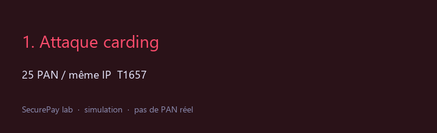
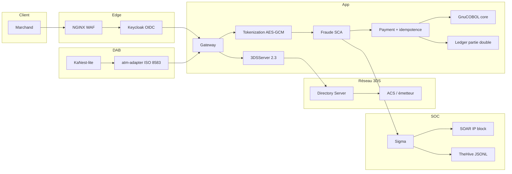
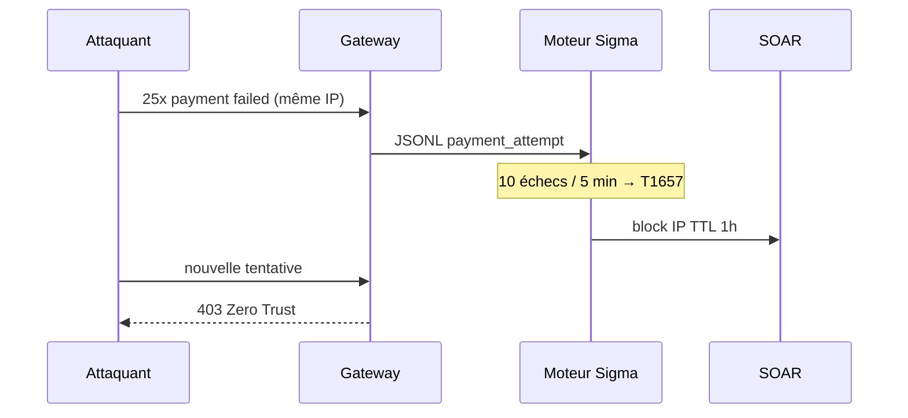
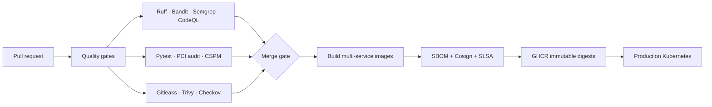

# SecurePay

[](https://github.com/youssefzaoujal/securePay/actions/workflows/ci.yml)
[](https://github.com/youssefzaoujal/securePay/actions/workflows/cd.yml)
[](https://slsa.dev/)
[](docs/security-controls.md)

## The 30-second version

SecurePay is a deliberately safe payment-security lab that connects a modern FastAPI payment platform to a simulated COBOL core, EMV 3DS network, SOC-as-Code detection plane, and hardened Kubernetes delivery path. It is built to answer one interview question with evidence: **what happens when a payment platform is attacked, degraded, or audited?**

| See it | Proof in the repository |
|--------|-------------------------|
| A live command center | `python -m uvicorn dashboard:app --port 9000` |
| A complete payment path | OAuth2 → tokenization → fraud → 3DS2 → payment → COBOL |
| A real security loop | Attack simulator → Sigma → MITRE → SOAR block → TheHive case |
| Production-minded delivery | GitHub Actions → SAST/SCA → SBOM → Cosign → GHCR → Kubernetes |

**Recommended recruiter path:** open the [architecture poster](docs/assets/securepay-architecture.png), run the [five-minute lab](#démarrage-lab-windows--docker), then read the [attack lab](docs/attack-lab.md) and [security metrics](docs/SECURITY_METRICS.md).

> **Ceci est une simulation. Aucune donnée de carte réelle n’est traitée.**
> Utilisez uniquement des PAN de test (`4111111111111111`). Ce n’est pas un PSP, pas un acquéreur, pas un environnement PCI-DSS / CIS certifié.

Flagship unique qui **fusionne** GuardianPay, SentinelPay, ThreatDetect, Home SOC et le scanner CSPM : une gateway de paiement que tu threat-model, que tu pipelines, que tu attaques toi-même, et dont les défenses **tirent vraiment**.

### Why it stands out

- **Systems thinking:** modern APIs, legacy COBOL, 3DS, ISO 8583, Kafka, gRPC, Vault and Kubernetes are connected by explicit trust boundaries.
- **Security that executes:** BOLA, carding, SQLi, JWT replay and fail-closed chaos scenarios have both controls and detection evidence.
- **Supply-chain discipline:** quality gates, Gitleaks, CodeQL, Semgrep, Trivy, CycloneDX, Cosign and SLSA are part of the delivery story.
- **Banking realism without unsafe data:** test PANs only, CVV destruction, redacted JSON events, mTLS adapters and reproducible local services.

### Read it like an engineer

1. **Start with the [Command Center](#démarrage-lab-windows--docker)** to see the payment, SOC, ATM and platform surfaces.
2. **Trigger `carding`** and watch the full detection-to-response chain in the SOC tab.
3. **Inspect the [security controls](docs/security-controls.md)** and the [threat model](docs/threat-model.md) to see why each control exists.
4. **Run the tests and audits** before trusting a claim: the repository favors measured evidence over marketing numbers.

| Brief d’origine | Où c’est dans ce repo |
|-----------------|------------------------|
| GuardianPay (gateway + DevSecOps + Elastic) | `gateway/` · `.github/workflows/` · compose profile `elk` |
| SentinelPay (attaque lab + SOAR + shift-left) | `docs/attack-lab.md` · `detection/soar/` · Gitleaks/Checkov/Trivy |
| ThreatDetect / Home SOC | Sigma · Wazuh · Loki · Juice Shop `purple` · rapport purple-team |
| CSPM CIS AWS | `python -m cspm` · `cspm/` |
| PCI / OWASP API Top 10 | tokenisation · BOLA · [`docs/owasp-api-top10.md`](docs/owasp-api-top10.md) |
| EMV 3DS 2.3.1 (3DSServer/DS/ACS) | `three_ds/` `directory_server/` `acs_simulator/` `legacy_3ds1/` · [`docs/3ds-flow.md`](docs/3ds-flow.md) |




> Poster haute résolution généré par `scripts/generate_architecture_png.py`. Il présente les quatre plans du système : edge & identité, paiement, opérations de sécurité et delivery platform.

> GIF : storyboard du lab (pas un screen record). Demo cliquable : [http://localhost:9000](http://localhost:9000) → SOC → Card testing → Évaluer.





---

| Pilier | Ce que les recruteurs Pismo / Adyen-scale voient |
|--------|--------------------------------------------------|
| **A — Payment platform** | OAuth2/OIDC, anti-BOLA, AES-256-GCM, CVV jamais stocké, webhooks HMAC, 3DS2, vélocité carding |
| **B — Detection & Response** | JSONL → moteur Sigma-as-code → ATT&CK → TheHive JSONL → runbooks IR |
| **C — Hardened platform** | Terraform (+ Azure stub), Helm, k3s, Kyverno Cosign Audit, Falco, Vault, default-deny, namespaces tenants |

---

## Architecture

### Delivery pipeline



Chaque image publiée est signée en keyless avec Cosign et accompagnée de son SBOM CycloneDX. Le déploiement de production attend la fin du build matriciel, puis vérifie le rollout Kubernetes.

```
                         INTERNET
                            │
                            ▼
                 ┌──────────────────────┐
                 │  NGINX  TLS 1.3      │
                 │  Rate-limit + WAF    │
                 └──────────┬───────────┘
                            ▼
                 ┌──────────────────────┐
                 │ Keycloak OAuth2/OIDC │
                 │ RS256 JWKS · MFA lab │
                 └──────────┬───────────┘
                            ▼
                 ┌──────────────────────┐
                 │ Gateway FastAPI      │
                 │ JWT · BOLA · corr-id │
                 └──────────┬───────────┘
            ┌───────────────┼────────────────┐
            ▼               ▼                ▼                ▼
     Tokenization      Fraud+3DS2         Payment      legacy-core
     AES-256-GCM       velocity+IF        capture      GnuCOBOL
     CVV détruit       SCA challenge      HMAC         solde compte
            │               │                │                │
            └───────────────┼────────────────┴────────────────┘
                            ▼
              JSONL events (PCI Req 10, PAN rédigé)
                            ▼
              Sigma engine · Wazuh rules · Grafana sécu · TheHive JSONL
                            ▼
              K8s: Kyverno/OPA · Cosign Audit · Falco · Vault · NetPol · tenants
```

Flux transaction (ce que l’auditeur veut entendre) :

1. Le **merchant_id vient du JWT**, jamais du body (OWASP API1 / BOLA).
2. Le PAN entre uniquement dans le **tokenization service**, ressort en `tok_…`.
3. Le **CVV n’est jamais persisté** (PCI-DSS Req 3.2.2).
4. Le moteur fraude compte la **vélocité carte/IP** (card testing) + Isolation Forest.
5. Score `review` → **challenge 3DS2** (OTP lab). Score `decline` → 403. **Tout paiement passe par le 3DS Server 2.3.1** — frictionless authentifié (CAVV+ECI) ou challenge — jamais de contournement SCA.
6. **3DS Server** orchestre AReq/ARes/CReq/CRes/RReq avec le **Directory Server** (routage BIN) et l’**ACS** (score RBA, OTP). CASV : HMAC-SHA256 tronquée (simulation HSM).
7. Payment interroge le **core COBOL** (solde compte) via adapter mTLS.
8. Paiement `succeeded` → **webhook HMAC-SHA256** `t=,v1=`.
9. La **reconcilation ledger** (partie double) émet un événement SOC en cas d’écart — `ledger_reconciliation_breakdown` Sigma.
10. Chaque décision est un **événement JSON** ingéré par le SOC, distribué **OpenTelemetry** (traceparent W3C).

---

## Démarrage lab (Windows / Docker)

```powershell
cp .env.example .env
docker compose up -d
# microservices API
docker compose --profile app up -d --build
# canal DAB (ISO 8583) — optionnel
docker compose --profile atm up -d --build
# Command Center
python -m uvicorn dashboard:app --port 9000
```

| Surface | URL |
|---------|-----|
| Command Center | http://localhost:9000 |
| Gateway | http://localhost:8000/docs |
| SOC engine | http://localhost:8010/docs |
| 3DS Server | http://localhost:8020/docs |
| Directory Server | http://localhost:8021/docs |
| ACS simulateur | http://localhost:8022/docs |
| Legacy 3DS 1.0 | http://localhost:8023 |
| Keycloak | http://localhost:8081 |
| Grafana | http://localhost:3000 |
| Vault (dev) | http://localhost:8200 |
| Prometheus | http://localhost:9090 |
| Loki | http://localhost:3100 |
| Kibana (profile elk) | http://localhost:5601 |
| Juice Shop (profile purple) | http://localhost:3001 |
| Webhook Node (profile webhooks) | http://localhost:8015 |
| ATM adapter (profile atm) | http://localhost:8016/docs |
| Core COBOL (profile app) | https://localhost:8004/health (mTLS) |
| SonarQube (profile sonar, RAM++) | http://localhost:9002 |

Token merchant :

```powershell
$body = "grant_type=client_credentials&client_id=merchant-api&client_secret=CHANGE_ME_IN_PRODUCTION"
Invoke-WebRequest -Uri "http://localhost:8081/realms/securepay/protocol/openid-connect/token" `
  -Method POST -Body $body -ContentType "application/x-www-form-urlencoded"
```

Attaques → Sigma :

```powershell
python -m detection.simulator.attack_generator --scenario carding --attempts 25
curl -X POST http://localhost:8010/evaluate
curl http://localhost:8010/soar/blocks
curl http://localhost:8010/hive/cases
python -m cspm --mode fixture
python scripts/pci_audit.py
```

Profiles lourds :

```powershell
docker compose --profile elk up -d      # Elasticsearch + Kibana + Filebeat
docker compose --profile siem up -d     # Wazuh
docker compose --profile purple up -d   # OWASP Juice Shop
docker compose --profile webhooks up -d # receiver HMAC Node.js
docker compose --profile atm up -d      # adaptateur DAB ISO 8583 (10.8.0.0/24)
# docker compose --profile sonar up -d  # SonarQube Community (~2 Go RAM)

# Chaos engineering (Toxiproxy) — preuve fail-closed sous panne fraude/payment
docker compose --profile app --profile chaos up -d `
  -e FRAUD_SERVICE_URL=http://toxiproxy:18003 `
  -e TOKENIZATION_SERVICE_URL=http://toxiproxy:18002 `
  -e PAYMENT_SERVICE_URL=http://toxiproxy:18001
powershell -File scripts/inject_chaos.ps1 FraudDown   # gateway → 5xx, JAMAIS approve
powershell -File scripts/inject_chaos.ps1 RecoverAll  # top, toxics supprimés
```

---

## Structure

```
securepay/
├── shared/                 # JWKS, BOLA, rédaction PAN, HMAC, métriques, events SOC, tracing OTel
├── gateway/                # orchestration tokenize → fraud → 3DS → payment
├── payment/                # capture + onboarding merchant + BOLA GET + reconcilation ledger
├── legacy_core/            # GnuCOBOL VALIDATE + wrapper FastAPI mTLS
├── tokenization/           # coffre AES-256-GCM (CDE simulé)
├── fraud/                  # règles + vélocité + Isolation Forest + 3DS2
├── three_ds/               # EMV 3DS 2.3.1 : AReq/ARes, CReq/CRes, RReq, CAVV+ECI (port 8020)
├── directory_server/       # Directory Server : routage BIN → ACS, HMAC, buffer RReq (8021)
├── acs_simulator/          # ACS/émetteur : score RBA, challenge OTP, signature CAVV (8022)
├── legacy_3ds1/            # 3DS 1.0 : MPI+PAReq/PARes XML (migration depuis)/ (8023)
├── kafka_events/           # bus d'événements Kafka (KRaft) + repli JSONL + pont thread-safe
├── grpc_svc/               # backbone interne gRPC (protos, raw unary, client InProcess)
├── vault_integration/      # Vault : creds DB dynamiques, PKI, KV — client réel + DevVault
├── network_token/          # tokenisation émetteur (VTS/MDES-like) : PAN jamais stocké, domaine lié
├── hsm/                    # HSM : SoftwareHSM + backend PKCS#11 (CKA_EXTRACTABLE=FALSE)
├── openbanking/            # PSD2 : consentements AISP/PISP, code flow, SCA obligatoire PISP
├── iso20022/               # pacs.008 / pacs.002 / camt.053 (build + parse + IBAN mod-97)
├── compliance/             # Compliance as Code : controls.yaml PCI, assess.py (OSCAL-lite), rego OPA
├── detection/soar/         # SOAR : alerte → blocage IP
├── detection/hive/         # tickets TheHive (JSONL + API optionnelle)
├── detection/intel/        # bundle STIX 2.1 (OpenCTI)
├── detection/ads/          # stratégies de détection (format Palantir ADS)
├── atm/                    # canal DAB : ISO 8583, KaNest/ARGAUS/APTRA/ALM lite
├── cspm/                   # CIS AWS Foundations scanner (fixture / tf / boto3)
├── ansible/                # playbooks post-déploiement (Falco, Node Exporter)
├── supply-chain/cosign/    # clé publique lab + doc Sigstore
├── services/webhook-receiver/  # Node.js HMAC
├── k8s/ terraform/ services/  # alias GuardianPay / SentinelPay
├── docs/attack-lab.md purple-team-report.md owasp-api-top10.md zero-trust.md
│   ├── 3ds-flow.md         # EMVCo 2.3 : séquences frictionless/challenge, mapping transStatus
│   ├── ads.md              # cadre analytique Palantir ADS appliqué aux 11 règles Sigma
│   ├── SECURITY_METRICS.md # chiffres mesurés (générés, jamais inventés)
│   ├── engine/             # Sigma-lite live
│   ├── sigma/rules/        # carding, stuffing, BOLA, JWT, SQLi, PAN leak, ledger gap
│   ├── sigma/mappings/     # MITRE ATT&CK
│   ├── wazuh/              # règles SIEM
│   ├── simulator/          # générateur d’attaques
│   └── ir/                 # runbooks
├── k8s-security/           # pilier C — Kyverno, OPA, Falco, NetPol, Vault
├── infra/
│   ├── terraform/          # cloud-ready (VPC, EKS, RDS) + azure/
│   ├── pulumi/ cloudformation/
│   ├── helm/               # chart production
│   ├── k3s/                # path lab local
│   ├── kubernetes/         # manifests
│   ├── nginx/              # WAF / TLS / lab HTTP
│   ├── chaos/              # Toxiproxy (proxies.json) — test fail-closed
│   ├── chaos-mesh/         # PodChaos / NetworkChaos (délai, partition, kill)
│   ├── kafka/              # docker-compose KRaft (localhost:19092)
│   ├── istio/              # mesh-security (mTLS STRICT + AuthZ) + gateway ingress
│   ├── helmfile.yaml       # GitOps helmfile (dev/prod + sops)
│   ├── argocd/             # Argo CD Application (selfHeal)
│   ├── prometheus/ grafana/ keycloak/ postgres/
├── scripts/                # pci_audit · reconcile_ledger · benchmark_fraud · inject_chaos · security_metrics · hsm_demo · configure_vault
├── tests/ unit · integration · security · e2e/locust · nuclei/
└── .github/workflows/      # SAST, SBOM Syft, Trivy, Cosign CD, SLSA tags
```

---

## EMV 3DS 2.3.1 (simulation EMVCo)

Quatre services complètent la stack pour reproduire le réseau 3-D Secure :

| Service | Port | Rôle |
|---------|------|------|
| `three-ds-server` | 8020 | (3DS Server) construit l’AReq, orchestre DS/ACS, compile CReq/CRes, génère CAVV+ECI, retourne l’état au gateway |
| `directory-server` | 8021 | (Directory Server) authentifie les requêtes (HMAC), route le BIN vers l’ACS de l’émetteur, bufferise les RReq |
| `acs-simulator` | 8022 | (ACS) moteur de scoring RBA (vélocité, montant, IP, device), frictionless vs challenge OTP, signe le CAVV |
| `legacy-3ds1` | 8023 | MPI 3DS 1.0 (PAReq/PARes XML) — démos de migration et chute d’authentification |

Le gateway **authentifie désormais par défaut** : toute création de paiement passe par le
3DS Server — frictionless authentifié (transStatus `Y`, ECI/CAVV transmis au payment
service) ou challenge (état `pending` + `require_challenge`, complété via
`POST /api/v1/payments/{id}/3ds/challenge`). transStatus `N`/`R` → refus. Ceci reproduit
l’exigence SCA (PSD2) qui interdit le contournement silencieux.

Séquences EMVCo (frictionless + challenge), vocabulaire EMVCo, mapping ECI et points
d’extension : [`docs/3ds-flow.md`](docs/3ds-flow.md).

```powershell
# Test rapide du réseau 3DS sans UI
curl -X POST http://localhost:8020/api/v1/authenticate -H "Content-Type: application/json" `
  -d '{"transaction_id":"t1","amount":250,"currency":"EUR","merchant_id":"merchant-api",`
      `"card_token":"tok_test","card_last_four":"1111","card_brand":"visa",`
      `"ip_address":"10.3.3.3","device_channel":"BROWSER","device_info":{"device_ip":"10.3.3.3"},"merchant_category_code":"5999"}'
```

---

## Plateforme bancaire (Phase 2/3)

Backbone d'architecture bancaire et différentiateurs carte, documentés dans
[`docs/banking-stack.md`](docs/banking-stack.md) :

| Brique | Implémentation |
|--------|----------------|
| **Kafka** (KRaft) | `kafka_events/producer.py` — bus d'événements, repli JSONL si broker absent, **pont thread-safe** dans `shared/events.py` (zéro impact si `KAFKA_BOOTSTRAP_SERVERS` vide) |
| **gRPC interne** | `grpc_svc/` — protos `securepay.internal.v1`, raw unary server, client avec canal in-process (pas de stubs à compiler) |
| **Vault** | `vault_integration/client.py` — creds DB dynamiques (TTL), PKI, KV v2 ; `DevVaultClient` rejoue les contrats sans Vault |
| **Istio** | `infra/istio/` — PeerAuthentication STRICT (mTLS), default-deny, AuthZ par SPIFFE principal, gateway 443 |
| **GitOps** | Helm chart prod (8 services, migration hook Alembic) · `infra/helmfile.yaml` · `infra/argocd/application.yaml` |
| **Network token** | `network_token/` — provision idempotent, PAN **jamais stocké** (HMAC digest + hint), usage crypto-métriquement lié au domaine |
| **HSM** | `hsm/` — clés non-extractibles (`CKA_EXTRACTABLE=FALSE`), signature CAVV HMAC-SHA256 21B, KEK ; `python -m scripts.hsm_demo` |
| **Open Banking PSD2** | `openbanking/` — consentements AISP/PISP, code flow, **SCA OTP obligatoire pour PISP** |
| **ISO 20022** | `iso20022/` — pacs.008 / pacs.002 / camt.053, namespaces ISO réels, validation IBAN mod-97 |
| **Compliance as Code** | `compliance/` — inventaire PCI-DSS v4.0.1 (`controls.yaml`), scorer OSCAL-lite (`python -m compliance.assess`), règles OPA (rego) |
| **Chaos Mesh** | `infra/chaos-mesh/` — PodChaos kill, latence, partition réseau (complément Toxiproxy local) |

Les événements SOC partent en **JSONL et en Kafka simultanément** dès que
`KAFKA_BOOTSTRAP_SERVERS` est renseigné — sans aucun changement de code métier :

```powershell
docker compose -f infra/kafka/docker-compose.kafka.yml up -d     # KRaft local:19092
$env:KAFKA_BOOTSTRAP_SERVERS = "localhost:19092"
python -m scripts.reconcile_ledger                     # un émetteur → SOC écrit JSONL + Kafka
python -m kafka_events.consumer_probe                  # probe round-trip
```

---

## Menaces testées en lab (STRIDE → contrôle)

| Scénario | Contrôle applicatif | Détection |
|----------|---------------------|-----------|
| **BOLA** lecture `GET /payments/{id}` d’un autre merchant | `shared/bola.py` → 403 | Sigma `bola_attack.yml` T1213 |
| **JWT replay** | cache `jti` | `jwt_replay.yml` T1550.001 |
| **SQLi** `' OR 1=1 --` | SQLAlchemy bound params + 422 schéma | `sql_injection.yml` T1190 |
| **PAN dans les logs** | `shared/redaction.py` | `pan_leakage.yml` T1552 |
| **Card testing** | rate-limit + vélocité fraude | `card_testing_attack.yml` T1657 |
| **Credential stuffing** | Keycloak brute-force | `credential_stuffing.yml` T1110.004 |

Détail : [`docs/threat-model.md`](docs/threat-model.md) · [`docs/security-controls.md`](docs/security-controls.md) · [`docs/architecture.md`](docs/architecture.md)

---

## Plateforme Kubernetes

Path **lab** : [`infra/k3s`](infra/k3s) (k3d/k3s + Kustomize).  
Path **cloud** : [`infra/terraform`](infra/terraform) (VPC, EKS, RDS chiffré).

Chart Helm : [`infra/helm/securepay`](infra/helm/securepay) — déploie les **8 microservices**
(gateway, payment, tokenization, fraud, three-ds-server, directory-server, acs-simulator,
legacy-3ds1), Service, HPA gateway, NetworkPolicy **default-deny** + flux minimal
(gateway → payment/fraud/tokenization/3ds), annotations `securepay.io/trivy-scanned` pour
l’admission Kyverno, secrets (maître de chiffrement, secret 3DS) via Vault/Secret.

```powershell
helm upgrade --install securepay infra/helm/securepay -n securepay --create-namespace -f values.yaml
```

Admission (Enforce) :

- pas de privileged / pas de root
- limits CPU+RAM obligatoires
- registries autorisés
- **image-scan gate** (`securepay.io/trivy-scanned=pass`)
- **Cosign** (`verify-cosign.yml` Audit lab ; `verify-cosign-enforce.yml` + SBOM CycloneDX en prod)
- isolation **multi-tenant** (`k8s-security/namespaces/tenants.yml`)
- interdiction du tag `:latest`

Runtime : Falco (shell, egress inattendu, lecture `.pem` / `.env`, cryptominer).  
Réseau : default-deny + least-privilege.  
Secrets : Vault Agent Injector, politique least-privilege.

---

## CI / DevSecOps

Chaque PR (merge **bloqué** si tests, Gitleaks ou Trivy HIGH/CRITICAL cassent) :

lint → pytest → **Gitleaks** → Checkov → CSPM Terraform → Semgrep/CodeQL → **pip-audit** → **Trivy** → **SBOM CycloneDX** → audit PCI inspiré → build → ZAP (main).

CD (`main`) : push GHCR + **Cosign keyless**. Tags `v*` : provenance **SLSA** (générateur officiel). Voir [`docs/slsa.md`](docs/slsa.md).

Grafana : dashboard **SecurePay — Observabilité sécurité** (taux de détection, IP SOAR, latence Sigma).

---

## Entretien (phrase d’accroche)

« J'ai conçu SecurePay comme une plateforme de paiement sécurisée de bout en bout : CI/CD en forme SLSA (SBOM, Cosign), SOC-as-Code (Sigma, TheHive, STIX), Kubernetes durci (Kyverno + Falco + Network Policies). J'ai aussi simulé l'intégration d'un core banking COBOL (GnuCOBOL) derrière un adapter mTLS — le dialogue API moderne / mainframe que l'on retrouve en banque — et un canal DAB ISO 8583 (profils NCR / Diebold / Wincor / DN) avec recettes KaNest-lite, PV de recette et suivi d'anomalies façon ALM. J'ai attaqué mon propre lab (carding, BOLA, replay JWT) pour prouver que Sigma et le SOAR tirent vraiment. »

Docs : [`docs/attack-lab.md`](docs/attack-lab.md) · [`docs/3ds-flow.md`](docs/3ds-flow.md) · [`docs/blog/carding-sigma-soar.md`](docs/blog/carding-sigma-soar.md) · [`docs/purple-team-report.md`](docs/purple-team-report.md) · [`docs/owasp-api-top10.md`](docs/owasp-api-top10.md) · [`docs/soc-as-code.md`](docs/soc-as-code.md) · [`docs/ads.md`](docs/ads.md) · [`docs/SECURITY_METRICS.md`](docs/SECURITY_METRICS.md) · [`docs/slsa.md`](docs/slsa.md) · [`docs/iso27001.md`](docs/iso27001.md) · [`docs/ebios-rm.md`](docs/ebios-rm.md) · [`docs/legacy-cobol.md`](docs/legacy-cobol.md) · [`docs/atm-pfa-plan.md`](docs/atm-pfa-plan.md) · [`docs/functional-specs/dab.md`](docs/functional-specs/dab.md) · [`docs/banking-stack.md`](docs/banking-stack.md) · [`detection/ads/README.md`](detection/ads/README.md)

---

## Héritage bancaire (COBOL)

Microservice `legacy-core` : binaire **GnuCOBOL** (pas z/OS) appelé par `payment` pour APPROVED/DECLINED selon un solde fictif. Intégration durcie : mTLS lab, NetworkPolicy « payment only », validation stricte des argv, rate-limit anti-DoS mainframe.

Détail : [`docs/legacy-cobol.md`](docs/legacy-cobol.md)

---

## Canal DAB / PFA (simulation)

SecurePay reste le **cœur** (fraude, COBOL, ledger). Un automate de test envoie un ISO 8583 (MTI 0200) vers `atm-adapter`, qui répond 0210. Les outils PFA (KaNest, HP ALM, ARGAUS, APTRA Vision, MXA, VTE) sont **émulés** — aucune licence constructeur.

| Recette | Attendu |
|---------|---------|
| Retrait 50 € | RC `00` |
| Retrait 600 000 € | RC `51` |
| Dépôt valorisé | RC `00` + ledger |
| Dépôt non valorisé | RC `00` + VTE pending |
| LSB (liste de surveillance) | RC `62` |

Constructeurs (profils YAML) : **NCR**, **Diebold**, **WNX** (Wincor Nixdorf), **DN** (Diebold Nixdorf).

```powershell
python -m pytest tests/unit/test_atm_kanest.py -q
# Command Center → onglet DAB / PFA → Lancer les 5 recettes
# optionnel :
curl -X POST http://localhost:8016/kanest/run
```

Plan PFE : [`docs/atm-pfa-plan.md`](docs/atm-pfa-plan.md) · specs : [`docs/functional-specs/dab.md`](docs/functional-specs/dab.md)

---

## Tests

```powershell
pip install -e ".[dev]"
pytest tests/unit tests/security -v
```

**120 tests verts** (unit + security). Modules Phase 2/3 testés : Kafka (repli JSONL,
pont sans broker), gRPC (in-process + raw), Vault (`DevVaultClient`), network token,
HSM (non-extractibilité, CAVV), PSD2 (SCA PISP), ISO 20022 (round-trips), compliance.

**Chiffres défendables** (chaque nombre est mesuré, jamais inventé) :

```powershell
python -m scripts.benchmark_fraud_engine   # recall, FPR (hard-block vs friction SCA), precision, F1
python -m scripts.security_metrics         # génère docs/SECURITY_METRICS.md (MTTD, alertes Sigma, SOAR)
python -m scripts.reconcile_ledger         # rapprochement journalier (écarts → événement SOC)
python -m scripts.hsm_demo                 # provisioning HSM, signature CAVV, refus d'export
python -m compliance.assess --json         # inventaire PCI-DSS v4.0.1 évalué (OSCAL-lite)
python -m kafka_events.consumer_probe      # probe round-trip Kafka (repli JSONL sans broker)
```

Load : `locust -f tests/e2e/locustfile.py`.

---

## Conformité (inspirée, non certifiée)

| PCI-DSS v4.0.1 (bin) | Contrôle dans ce repo |
|---------|------------------------|
| 1–2 | NetworkPolicies default-deny, segmentation tokenization |
| 3 | Tokenisation AES-256-GCM, **CVV jamais stocké**, rédaction logs, challenge OTP 3DS à 3 essais max |
| 4 | TLS ≥1.2 (1.3 préféré) NGINX (path cloud), HSTS |
| 6 | SAST/DAST/deps/images dans GitHub Actions |
| 7–8 | Keycloak + scopes + BOLA object-level ; MFA **PRD pour tout accès interactif** (8.4.2) |
| 10 | JSON structuré, correlation-id, audit events, **revue automatisée des logs** (10.4.1.1) via Sigma, **tracing OpenTelemetry** |
| 11 | Falco + Sigma + Trivy + réconciliation ledger (11.6 — changements de config) |
| 12 | Runbooks IR + matrice ISO 27001 + EBIOS RM + `scripts/pci_audit.py` |

Audit automatisé (présence des contrôles dans le repo) : `python scripts/pci_audit.py`.

---

## Puces CV (prêtes à coller)

- Conception d’une passerelle de paiement microservices (OAuth2/OIDC, tokenisation PCI-inspirée, flux 3-D Secure 2 simulé).
- Durcissement API OWASP API Top 10 (BOLA, replay JWT, injection) ; pipeline GitHub Actions SAST/DAST/SCA/Gitleaks/Trivy qui bloque les findings critiques.
- Lab purple-team : règles Sigma mappées MITRE ATT&CK, tickets TheHive, intel STIX, réponse SOAR (blocage IP).
- Chaîne d'approvisionnement : SBOM CycloneDX, Cosign (Sigstore), provenance SLSA sur tags, Kyverno verifyImages.
- Scanner CSPM Python (CIS AWS Foundations) : S3 publics, IAM trop permissif, security groups 0.0.0.0/0 ; scan Terraform en CI.
- Intégration d'un simulateur core banking GnuCOBOL (adapter mTLS, sanitization anti-injection, NetworkPolicy least-privilege).
- Réseau EMV 3DS 2.3.1 simulé (3DS Server / Directory Server / ACS) : AReq-ARes, challenge OTP, CAVV+ECI, chute 3DS 1.0 — SCA appliquée par défaut, jamais contournée.
- Résilience fail-closed prouvée : chaos engineering Toxiproxy + tests bout-en-bout — si fraude/payment est down, le gateway répond 5xx, jamais un approve silencieux.
- SOC quantifié : stratégies de détection au format Palantir ADS, benchmark fraude style Adyen Protect (recall/FPR/precision/F1), MTTD mesuré — `docs/SECURITY_METRICS.md`.
- Backbone bancaire (Phase 2/3) : événements **Kafka** avec repli JSONL, **gRPC** interne sans compilation de stubs, **Vault** (creds dynamiques + PKI), **Istio mTLS STRICT**, Helm/helmfile/Argo CD ; différentiateurs carte : **network token** (VTS/MDES-like, PAN jamais stocké), **HSM** (clés non-extractibles), **Open Banking PSD2** (consentements AISP/PISP, SCA obligatoire), **ISO 20022** (pacs.008/002, camt.053), **Compliance as Code** (contrôles PCI v4.0.1 évalués automatiquement), **Chaos Mesh** (kill/latence/partition).

Licence MIT. **Simulation uniquement.**
