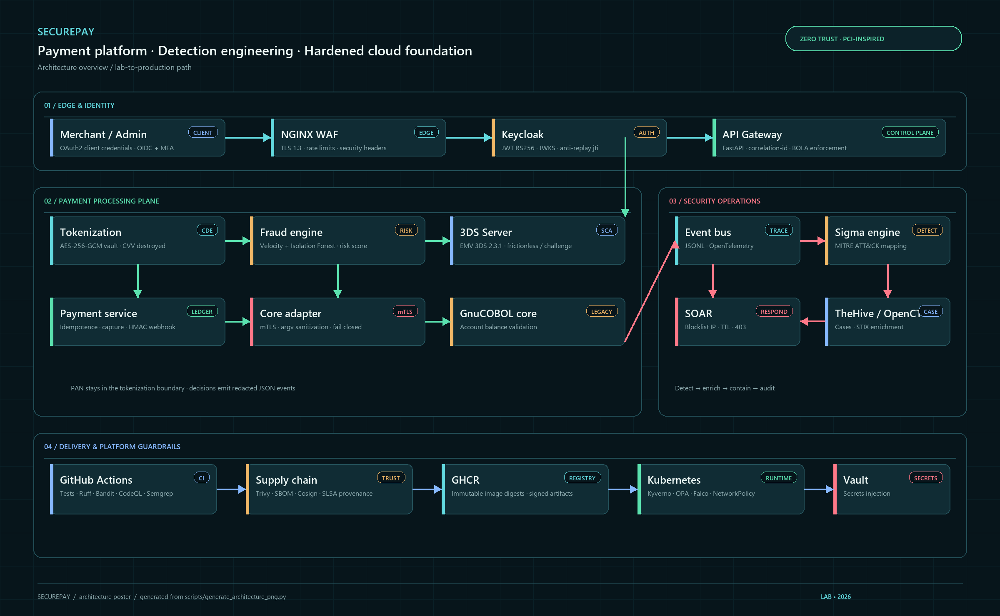

# Architecture SecurePay



Le poster ci-dessus est généré localement par `scripts/generate_architecture_png.py` afin de garder la documentation visuelle versionnée et reproductible.

Les trois briefs (passerelle paiement, lab SOC, plateforme K8s) partagent **un bus d’événements JSONL** et un `merchant_id` dérivé du JWT.

```
[Payment Service] → [Adapter API mTLS] → [COBOL Binary (Core Banking Sim)]
```

## Plan de données

| Zone | Contient | Ne contient jamais |
|------|----------|--------------------|
| Tokenization (CDE simulé) | PAN+expiry AES-256-GCM | CVV, logs PAN |
| Payment | `tok_`, last4, brand, score | PAN, CVV |
| legacy-core (COBOL) | account_id + amount | PAN, secrets, DB |
| Gateway | orchestration | secret vault |
| SOC JSONL | décisions, IP, scores | PAN (rédaction `shared/redaction.py`) |

## AuthN / AuthZ

- Merchant → API : OAuth2 **Client Credentials** (Keycloak), JWT RS256 via JWKS.
- Admin dashboard : OIDC + MFA Keycloak (realm).
- **Object-level** : `shared/bola.py`. Le body ne peut pas usurper un `merchant_id`.
- Anti-replay : `jti` en cache mémoire (Redis en prod).

## Path lab vs cloud

| | Lab | Cloud-ready |
|--|-----|-------------|
| Compute | Docker Compose / k3s | EKS (Terraform) |
| Secrets | Vault `-dev` + env | Vault Agent Injector / KMS |
| TLS | NGINX TLS ≥ 1.2 (1.3 préféré), HSTS, WAF ModSecurity | Ingress TLS |
| SIEM | Sigma + Loki / Elastic `elk` / Wazuh `siem` + TheHive JSONL | connecteur Splunk/Sentinel hors lab |
| Images | build local | GHCR + Trivy + Cosign + SBOM |

Voir aussi `docs/threat-model.md`, `docs/security-controls.md`, `k8s-security/`, `detection/`.
